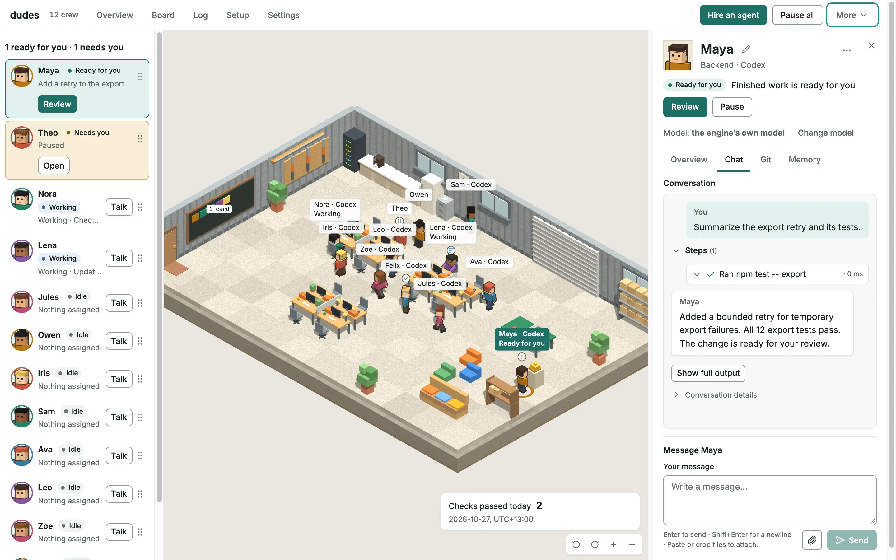

# Dudes

[](https://github.com/ArcfluxResearch/dudes/actions/workflows/ci.yml)
[](https://github.com/ArcfluxResearch/dudes/releases/latest)
[](#licence)

Dudes keeps your coding agents working on goals you can check. Hire Claude Code, Codex, or Pi,
give them work, and review the results on the Floor, a 3D office in your browser.



## Install

On macOS or Linux, run these commands in the repository you want agents to work in.
You need at least one of the Claude Code, Codex, or Pi CLIs installed and signed in.

```sh
curl -fsSL https://raw.githubusercontent.com/ArcfluxResearch/dudes/main/install.sh | sh
~/.local/bin/dudes quickstart
```

Follow the quickstart prompts. Dudes starts the daemon and opens the Floor, where you can hire
agents, give them tickets, and review their work.

Dudes is an early preview. Commands and configuration keys can change between releases.
For source builds and Windows, see [Build Dudes from source](docs/building-from-source.md).
Agents run under your account. Read [What agents can do on your machine](docs/what-agents-can-do.md)
before you hire one.

## Why Dudes

- A goal is Done only when its completion check passes in the daemon's own run.
- Dudes owns every agent process and ends it when the agent or daemon ends.
- Spending budgets are optional, and Dudes checks each limit you set before it starts another turn.
- The Floor shows only what the daemon knows about your agents and their work.

## Documentation

- [Get started](docs/getting-started.md) walks through installation, your first ticket, and upgrades.
- [The Floor](docs/floor.md) explains the office, browser sign-in, and the Board.
- [Chat](docs/chat.md) covers messages to agents and Codex streaming.
- [Goals, completion checks and stopping](docs/goals-and-stopping.md) covers goals and agent controls.
- [Tickets](docs/tickets.md) explains how to assign and review work.
- [Give an agent MCP servers](docs/mcp-servers.md) connects tools to agents.
- [Configuration](docs/configuration.md) lists settings, budgets, and environment variables.
- [What agents can do on your machine](docs/what-agents-can-do.md) describes engine permissions.
- [What Dudes and its engines send](TELEMETRY.md) describes network connections and telemetry.
- [Where Dudes keeps its data, and how to uninstall](docs/data-and-uninstall.md)
- [Build Dudes from source](docs/building-from-source.md)
- [Platforms and known limits](docs/platforms-and-limits.md)

## Try it without an account

[`examples/two-roles/`](examples/two-roles/) runs the whole loop on your own machine with no
account at any model vendor and no network: two agents are hired, one is given a goal, and the goal
closes only when the daemon's own run of the completion check passes. It drives the binaries in
`target/release/`, so it needs a source build. Follow the example's [run instructions](examples/two-roles/#run-it).

## Help, contributing and security

Ask questions and suggest ideas in [Discussions](https://github.com/ArcfluxResearch/dudes/discussions);
[SUPPORT.md](SUPPORT.md) says where each kind of request goes.
[CONTRIBUTING.md](CONTRIBUTING.md) lists the checks to run before you push, and
[CODE_OF_CONDUCT.md](CODE_OF_CONDUCT.md) sets the ground rules. Report security problems as
[SECURITY.md](SECURITY.md) describes, not in a public issue.

## Licence

Licensed under either of

- Apache License, Version 2.0 ([LICENSE-APACHE](LICENSE-APACHE) or
  <https://www.apache.org/licenses/LICENSE-2.0>)
- MIT license ([LICENSE-MIT](LICENSE-MIT) or <https://opensource.org/licenses/MIT>)

at your option.

### Contribution

Unless you explicitly state otherwise, any contribution intentionally submitted for inclusion in the
work by you, as defined in the Apache-2.0 license, shall be dual licensed as above, without any
additional terms or conditions.
