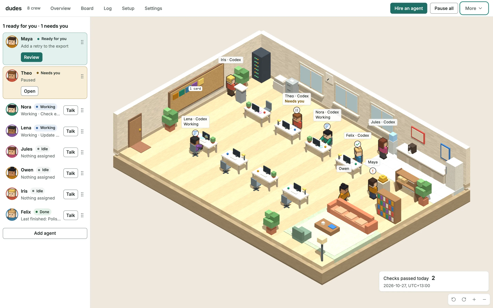
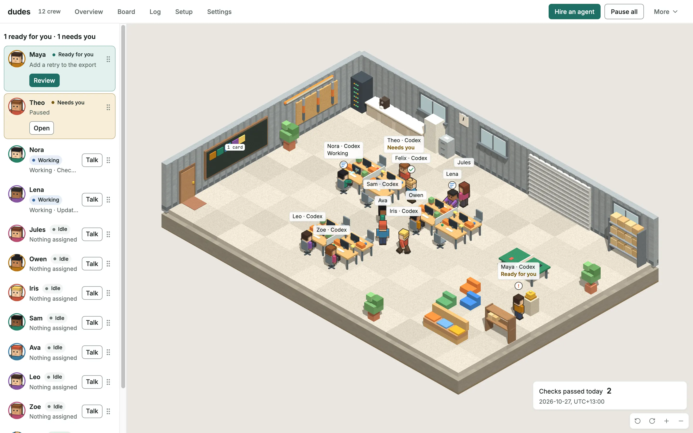
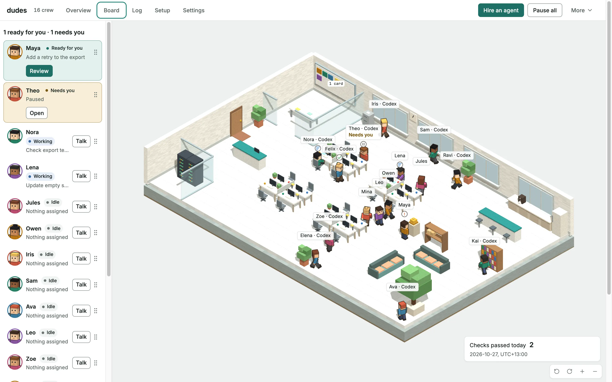

# The Floor

The Floor is the browser view that the link from `dudes floor open` opens. The daemon's state decides where each
agent stands in the office:

- While a turn runs, the agent types at its desk.
- Between turns, it stands at the goal board while the daemon runs the goal's completion check.
- An agent that waits for your answer sits in the lounge under a question mark. An agent on Hold,
  or one that a ceiling or its hop cap stopped, sits there too.
- When the daemon's own run of the completion check passes, the goal is Done and the agent rings
  the bell. What an agent reports about its own work never rings it.

A new hire walks in through the door, and a retired agent walks out. While every agent is paused,
the office dims. Click an agent in the office or in **Crew** to open the drawer, which shows its
goal and status and the Floor actions you turned on, such as answering its question, pausing it or
changing its goal. The drawer opens to a conversation and a message box.
You can send the first message without assigning a goal, watch the reply arrive, and send a
follow-up. A message sent during a turn waits for that turn to finish. Each message to an agent
without a goal authorizes one turn; messages to an agent with a goal join its next task.

The office is a view of the daemon's state, never a source of truth. The daemon's journal, an append-only log of everything it records, is the
only record, and the Floor changes that state only through the Floor actions you turn on. `dudes quickstart` asks once whether to turn on hire,
pause, answer, change goals, retire and attach a terminal together.

The Floor draws the smallest office that seats the whole crew. The Studio has 8 desks, the Workshop
has 12 and HQ has 16. **Settings** can pin one office in this browser instead. When the office has
fewer desks than the crew, the agents without a desk queue by the door, and any past the queue
stand along the back wall. From left to right, the Studio with eight agents, the Workshop with
twelve and HQ with sixteen:

  
  
  

## Open the Floor

`dudes floor open` prints a one-time sign-in link, and `dudes quickstart` prints one when it
finishes. Paste the link into any browser, on this computer, within 60 seconds. Dudes opens no
browser for you, so the link goes to the browser you choose and never to one you did not.

A link works once, in one browser. Once a browser has used it, that browser keeps its own session,
and the same link pasted into a second browser, or reloaded after it expired, is refused. The page
then says so and tells you to run `dudes floor open` again for a new link. Copying the address from
the browser's address bar does not help, because the browser removes the secret from the address as
soon as it signs in. `dudes stop` and `dudes start` end every Floor session; [after you
upgrade](#after-you-upgrade) explains what `dudes upgrade` does instead. The daemon allows four Floor sessions at a time. `--no-browser` is still
accepted and changes nothing, because printing is now the default. The link is a loopback address, so on a remote machine forward the port first, for example `ssh -L <port>:127.0.0.1:<port> <host>`, and paste the link into a browser on your own computer.

**Setup** shows each engine the daemon turned on and whether it found that engine's program on its
`PATH`. **Settings** shows the running Floor switches, budget ceilings, per-turn reserves,
registered providers and enrolled workspace labels. The Floor reads configuration without editing
it. **About**, within Settings, shows the daemon, Floor build and browser wire versions.

## Tickets

With `floor.board` on, the Board view makes tickets and moves them. It needs `floor.control` and
`floor.goal` on too, and the daemon refuses to start without them. Turn it on with
`dudes config set floor.board on`, then restart the daemon. `dudes quickstart` turns it on with the
other Floor actions when you say yes to its one question.

**Giving a ticket to an agent starts that agent, which then runs and spends under your account.**
Anyone holding your Floor session can do that until the session ends, so keep the link to yourself.
Set a spending limit when your account bills per use.

- **New ticket.** A title is all it needs. The note, the project, the "Done when" check and the
  agent are optional. The project is asked for only when more than one is enrolled. With no agent
  hired, the form says so and offers to hire one.
- **The board.** To do, Working, Ready for you and Done, and a Needs you row for tickets that are
  stuck. Done shows the newest 20. A card shows the title, the agent, its place in the queue or why
  it waits, and in Needs you the sentence that names the next step.
- **A ticket.** Open a card to read its note, what the agent says it did, the check result and the
  files that changed. The agent's words are shown as plain text. The files come from the Git tab,
  so they need `floor.git` on.
- **Actions.** Give to agent, Edit and Remove for a ticket nobody has started. Stop for one that is
  Working. Accept, Ask for changes and Remove for one that is Ready for you. Try again, Stop and
  Remove for one in Needs you. Remove for one that is Done, to clear it off the board. Accept is your verdict that the work is what you asked for. The check
  passing only means the daemon's own run passed.
- **Banner.** The top bar says how many tickets are ready for you or need you, and how many agents
  working a ticket are asking you a question. Overview lists the tickets under Waiting on you. A
  turn ending never raises it. While a ticket waits for you, its agent's crew pill and the top
  bar's count read "ready for you" or "needs you" instead of "done", and the old goal-done notice
  is not shown for it.

[Tickets](tickets.md) covers the same actions from the command line.

## After you upgrade

After upgrading Dudes, copy any unsent drafts before reloading an open Floor tab. The daemon and
Floor bundle must have matching release and browser protocol versions. An older open tab cannot
connect to an incompatible daemon. Reload the tab explicitly to load the installed bundle.

`dudes upgrade` keeps the Floor sign-ins that are open when it starts, so a reload is all it
takes. After the reload the tab is signed in again and shows the same agents, with no new link.
The sign-in keeps its original time limits: the idle limit of 30 minutes, and the eight-hour limit
that counts from the first sign-in. Ticket and check allowances carry over too, so an upgrade does
not refill them.

Only `dudes upgrade` carries sign-ins. A plain `dudes stop` and `dudes start` signs every browser
out. The reload then asks you to run `dudes floor open`, which is also the way to end every Floor
session at once. An upgrade that cannot keep a sign-in, for example because the Floor comes back on
a different port or the upgrade is interrupted, ends the same way.

The first upgrade from a version that predates this feature still signs open tabs out, because
the older daemon cannot hand its sign-ins over.

One sign-in serves one tab at a time. If you opened a second tab with the same sign-in, it asks you
to sign in again after the reload.

## Serve the Floor

The daemon serves the Floor at `/floor/` on `127.0.0.1`. It takes the Floor bundle from a `floor`
directory beside the `duded` executable, where `cargo xtask dist` puts it, or else, when the
executable sits in a directory named `bin`, from `share/dudes/floor` beside that directory, where
the install script puts it. On Unix, the daemon refuses to start with a `share/dudes/floor` that
neither you nor root owns, or that its group or others can write. A `duded` started directly, not
through `dudes quickstart`, can name another bundle with `DUDES_FLOOR_ASSETS`, which takes
precedence, for example `DUDES_FLOOR_ASSETS="$PWD/floor/dist" cargo run -p duded` in a checkout.
With none of these, the Floor listener is disabled, and `dudes floor open` says what
to do.

`DUDES_FLOOR_ASSETS`, when present, must name an existing absolute release-bundle directory;
relative and empty paths stop startup. `DUDES_FLOOR_PORT` applies to either bundle and must be
unsigned ASCII decimal that fits `u16`; `0` asks the operating system for a free port, and a taken
port stops startup. Without it, the daemon first asks for the port its last run bound, which it
keeps in a `floor-port` file in the state directory, and takes a free port when that one is taken.
The Floor's address then stays the same across restarts, so the roster order a
browser keeps for it survives `dudes stop` and `dudes start`, and it is what lets `dudes upgrade` keep
your sign-ins. The startup line and
`dudes floor open` both show the port chosen. `dudes quickstart` and `dudes start` pass
neither variable to the daemon. Dudes always binds `127.0.0.1`; neither variable can change the host.

The release manifest proves that the directory is internally complete and version-matched. It does
not prove where those files came from or grant them access to daemon data. A bundle that fails the
manifest check stops startup, whichever way it was found. The path and port are non-secret and appear
in startup diagnostics, so do not put credentials in either value.

